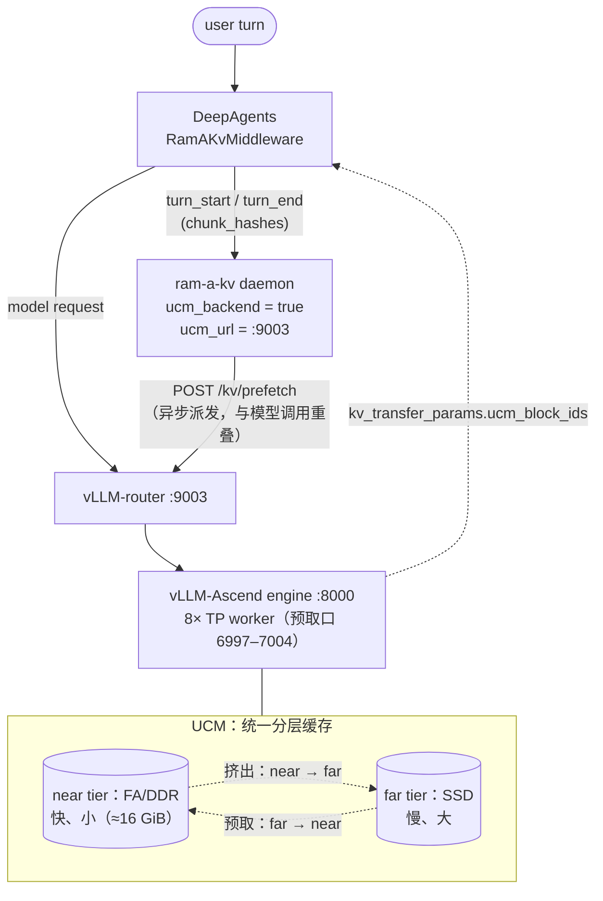

# DeepAgents × RAM-A:KV 预取收益实验

**摘要** — 本实验以真实的 [DeepAgents](https://docs.langchain.com/oss/python/deepagents) agent 会话为负载,量化 **ram-a-kv 预取**在「模型调用」与「整轮 agent 交互」两个口径上的时延收益。实验采用**两档对照**:近端(FA/DDR)容量小且被所有请求共享,一个会话的 KV 在其它请求持续写入下会被驱逐到 SSD,因此**默认(不预取)即为冷态**——预填充须从 SSD 回源;`prefetch` 则在 `turn_start` 把该会话 KV 拉回近端。在 **32k / 64k / 128k / 256k** token 四个上下文上,整轮加速比为 **1.10× → 1.36×**（token 数由引擎 `/tokenize` 真实校准，并经引擎回传 `prompt_tokens` 复核）。

***

## 1 背景与动机

多轮 agent 会话中,每一步推理的预填充阶段都需要把该会话的上下文 KV 从缓存层级读入显存。UCM 采用分层缓存:**近端(FA/DDR)容量小、带宽高**,其上为**远端(SSD)容量大、带宽低**。当一个会话的 KV 被后续流量挤出近端后,其预填充只能从 SSD 回源,直接抬高首 token 时延(TTFT)。

RAM-A 的预取机制在模型调用**之前**把该会话的 KV 块从 SSD 重新拉回近端,以把后续预填充的 `T_kv_load` 从「SSD 读」降为「DDR 读」。本实验的动机是:以真实 DeepAgents 负载为口径,**量化该机制在整轮 agent 交互上的端到端收益**,并给出一套可被第三方复现与审计的实验设计。

***

## 2 系统模型与原理

### 2.1 组件与数据流



- **模型调用**经 vLLM-router(:9003)转发至 vLLM-Ascend 引擎(:8000);该引擎启用了 UCM,故请求的 KV 由 UCM 分层缓存管理,响应因此携带 `kv_transfer_params.ucm_block_ids`。
- **middleware** 在模型调用前后,把 `turn_start` / `turn_end`(携带 `chunk_hashes`)上报 daemon。
- **daemon**(`ucm_backend`)在 `turn_start` 时判定是否预取该会话的块,并经同一 vLLM-router 扇出到 8 个 TP worker。

### 2.2 时延分解

一次 agent turn 的墙钟时延可分解为:

```
T_turn  ≈ T_agent + T_model
T_model ≈ T_queue + T_prefill + T_decode
T_prefill = T_compute + T_kv_load
```

其中与预取相关的仅有 **`T_kv_load`** —— 预填充阶段把该会话 KV 读入的过程:

```
T_kv_load = hits_near_tier ? T_ddr : T_ssd        (T_ssd ≫ T_ddr)
```

### 2.3 预取收益的构成

`turn_start` 预取在模型调用之前把该会话的块从 SSD 拉回近端,从而:

```
cold:      T_kv_load = T_ssd
prefetch:  T_kv_load = T_ddr,  代价是一次额外的扇出开销 C_fanout
```

单看模型侧,理想收益为 `Δ = T_ssd − T_ddr`。整轮是否获益,取决于 `C_fanout` 是否落在关键路径上:

```
整轮净收益 ≈ Δ − 未与模型调用重叠的 C_fanout
```

**ram-a-kv 以异步方式派发** **`turn_start`** **预取**:daemon 收到 `turn_start` 后立即返回,`/kv/prefetch` 的扇出在后台进行、与随后的模型调用**重叠**,故 `C_fanout` 基本被隐藏,整轮收益 ≈ `Δ`(见 §2.1 图)。本实验统一采用该异步模式(§4.4、§7 的 `TURN_START_ASYNC=1`)。

***

## 3 术语

| 术语                        | 定义                                           |
| ------------------------- | -------------------------------------------- |
| 近端 / near tier            | FA/DDR 缓存层,容量小、带宽高;本环境 FA ≈ 16 GiB           |
| 远端 / far tier             | SSD 缓存层,容量大、带宽低                              |
| turn                      | 一次 agent 交互:一次模型调用及其前后 middleware 上报         |
| `turn_start` / `turn_end` | middleware 在模型调用前/后向 daemon 上报的事件            |
| chunk / block             | KV 缓存块;本实验按引擎块 ≈ 128 token/块估算               |
| `Δ`                       | 单次预取省下的读取时延,`Δ = T_ssd − T_ddr`              |
| `C_fanout`                | daemon 经 vLLM-router 向 8 个 TP worker 扇出预取的开销 |
| `thread_id`               | 会话标识;每档测一次独立会话,避免前缀缓存串扰                      |

***

## 4 实验设计

### 4.1 研究问题

- 在真实 DeepAgents 会话上,预取能否降低整轮交互时延?收益的量级与随上下文的变化规律如何?

### 4.2 变量与响应指标

- **自变量**:预取开关(开 / 关)。
- **控制变量**:上下文规模(32k / 64k / 128k / 256k token)、`max_tokens`、`temperature`、探针 prompt、会话隔离、近端初始状态。
  - token 口径为**引擎回传的 `prompt_tokens`**(整条 prompt,含 DeepAgents 系统提示/探针/模板等固定脚手架)。生成器用引擎 `/tokenize` 真实校准材料长度,并按 `SCAFFOLD_TOKENS`(默认 2817)从目标中扣除该固定开销,使实测 `prompt_tokens` ≈ 目标(实测偏差 < 0.1%)。
- **响应指标**:

| 指标                | 定义                                            | 采集方式                                                       |
| ----------------- | --------------------------------------------- | ---------------------------------------------------------- |
| `latency_s`       | 整轮 `agent.invoke`(图调度 + middleware 上报 + 模型调用) | 用户实际感知的一次交互                                                |
| `model_latency_s` | 仅 chat 模型调用(预填充 + 解码)                         | LangChain callback(`on_chat_model_start` / `on_llm_end`)计时 |

`max_tokens=32`、`temperature=0` 固定,使生成段尽量短,把差异集中在预填充 / KV 读入。

### 4.3 对照组:两档设计

实验只对照两档——**不预取(基线)与**预取:

| 档位         | 近端(FA/DDR)状态          | daemon 预取 | 含义                 |
| ---------- | --------------------- | --------- | ------------------ |
| `cold`     | **冷**:会话 KV 已被挤出到 SSD | 关         | **基线**:预填充从 SSD 回源 |
| `prefetch` | 冷(同上)                 | 开         | 预取把该会话 KV 搬回近端     |

**为什么** **`cold`** **是默认状态**:近端(FA/DDR)容量小且被所有请求共享,一个会话的 KV 在其它请求持续写入下很快被驱逐到 SSD。因此对一个稍后再次访问该会话的 turn 而言,**近端为冷、预填充须从 SSD 回源是常态**,`cold` 即代表这一常态——无需额外构造「热」对照。

映射到 §2.2 的时延模型:

- `cold` ≈ `T_compute + T_ssd`(基准);
- `prefetch` ≈ `T_compute + T_ddr + 未重叠的 C_fanout`(理想情况下 ≈ `T_ddr`)。

### 4.4 实验流程

流程分三个阶段:`warm`(构建上下文)、`flush`(复现冷态)、`measure`(逐档测量)。

1. **warm(上下文构建)**:把起始 prompt 完整跑一遍,产生一次真实模型调用;`turn_end` 把该会话的 `chunk_hashes` 写入 daemon 会话表,并把整段上下文的 KV dump 到 SSD/DDR。对话消息序列保存为 `data/context_<thread>.json`,供后续原样复用。
2. **flush(复现冷态)**:用 UCM 预放池中的确定性长 prompt 重放若干条(`FLUSH_ENTRIES`,默认 16 条 ≈ 25.6 GiB),把近端挤出——等价于「被其它请求驱逐」,保证待测会话为冷态。
3. **measure(测量)**:将保存的上下文**原样重载**,拼接一个**固定 probe**,令 agent 重新推理:

| 档位         | 近端 flush | daemon 触发                        | 目的   |
| ---------- | -------- | -------------------------------- | ---- |
| `cold`     | 是        | `turn_start_prefetch=false`      | 基准   |
| `prefetch` | 是        | `turn_start_prefetch=true`(异步派发) | 待测收益 |

### 4.5 冷启动与近端挤出门槛

**必须 flush 的原因**:若近端在 warm 之后仍为热,则 `cold` 也会命中 DDR,两档差异被人为抹平。**需要的量**:挤出门槛 ≈ `1.2 ×` 近端容量。本引擎以 `UCM_CACHE_BUFFER_CAPACITY_GB=32` 启动,`FA = capacity/2 = 16 GiB`,门槛 ≈ **19.2 GiB**:

- 放 12 条(= 19.2 GB)恰好压在门槛上 ⇒ 是否淘汰**不确定**,冷态时有时无;
- 放 16 条(= 25.6 GB,一整组)留出约 33% 冗余 ⇒ 稳定复现冷态。

修改引擎容量后须同步调整 `FLUSH_ENTRIES`(≥ ⌈1.2 × FA / 1.6 GB⌉)。

***

## 5 运行环境与前置条件

1. **推理栈在运行**:vLLM-Ascend 引擎 `:8000`(启用 UCM)+ vLLM-router `:9003`,且 TP worker 预取口 `6997–7004` 已监听。
2. **ram-a-kv 已构建**:`cargo build --release`,`target/release/ram-a-kv` 存在。
3. **预放池存在**:`/mnt/sdb/ucm/flush_pool_64g.json`。
4. **Python 环境**:一个能 `import deepagents, langchain_openai, ram_a_middleware` 的解释器。脚本会自动探测,亦可用 `VENV_PY=` 显式指定。

***

## 6 复现指南

### 6.1 一键运行

在项目目录下执行(脚本自行探测 python 与 daemon 二进制):

```bash
cd ram-a-kv/tests/deepagent
SWEEP=32768,65536,131072,262144 REPS=3 MIN_SIZE=32768 HUMAN_TOKEN_LIMIT=1000000 ./run_deepagent_gain.sh
```

常用变体:

```bash
cd ram-a-kv/tests/deepagent

# (A) 四档扫描(推荐,主结果)
SWEEP=32768,65536,131072,262144 REPS=3 MIN_SIZE=32768 HUMAN_TOKEN_LIMIT=1000000 ./run_deepagent_gain.sh

# (B) 单尺寸、自定义长 prompt(文件传入,避免 argv 长度上限)
PROMPT_FILE=/path/to/prompt.txt REPS=3 ./run_deepagent_gain.sh

# (C) 短 prompt 内联传入
./run_deepagent_gain.sh "请总结预取如何降低首 token 时延?"

# (D) 不做冷 flush(更快;但近端仍热,两档差异被抹平)
FLUSH=0 SWEEP=65536 ./run_deepagent_gain.sh
```

> 测 >45k token 的上下文需放开单条消息上限:`HUMAN_TOKEN_LIMIT=1000000`(见 §7)。

### 6.2 输出产物

所有产物统一落在**单一输出目录** `data/`(可用 `DATA_DIR` 改名),运行完直接打开 **`data/RESULT.md`** 即可看到结果:

| 文件                                          | 内容                                           |
| ------------------------------------------- | -------------------------------------------- |
| **`data/RESULT.md`**                        | **结果速览:各尺寸的冷 / 预取平均时延 + 提升百分比 + 一句话结论**(首选)  |
| `data/results.jsonl`                        | 逐次原始记录(含 mode / size / rep / flushed / 两个时延) |
| `data/summary.json`                         | 按尺寸与档位聚合 + 收益比                               |
| `data/report.md`                            | 可直接引用的完整 markdown 汇总表(含环境指纹)                 |
| `data/run_env.json`                         | 本次运行的环境指纹                                    |
| `data/daemon.log`                           | daemon 日志                                    |
| `data/context_*.json` / `data/prompt_*.txt` | 各尺寸复用的上下文与 prompt                            |
| `data/sessions.db`                          | daemon 会话表                                   |

### 6.3 故障排查

| 现象                           | 可能原因                                          | 处理                                           |
| ---------------------------- | --------------------------------------------- | -------------------------------------------- |
| 两档几乎一致                       | 未冷启动(近端仍热)                                    | 确认 `FLUSH=1` 且 `FLUSH_ENTRIES × 单条大小 > 近端容量` |
| 同一尺寸两次结论不同                   | 引擎分钟级漂移(±10–15%)                              | 提高 `REPS`;跨运行合并(`APPEND=1`);取中位              |
| warm 的 `chunk_hashes` 很少或为 0 | prompt 被框架转存(超 200k 字符),或引擎未回 `ucm_block_ids` | 缩小 prompt;检查引擎 `kv_transfer_params`          |
| `prefetch` 方差很大              | 引擎 / worker 抖动或扇出偶发排队                         | 增大 `REPS`,观察中位与标准差                           |
| `port 7098 already in use`   | 存在残留 daemon                                   | 更换 `RAM_A_PORT`,或先停占用进程(脚本不会误用)              |
| 收益偏小                         | 上下文太小(小 KV 的改进空间小于噪声)                         | 增大 `SWEEP`;主结果从 ≥32k 起                       |

***

## 7 参数参考

| 变量                  | 默认                                 | 说明                                            |
| ------------------- | ---------------------------------- | --------------------------------------------- |
| `SWEEP`             | 空                                  | 多尺寸扫描的 token 列表,如 `32768,65536,131072,262144` |
| `PROMPT_FILE`       | 空                                  | 单尺寸模式的起始 prompt 文件                            |
| `MODEL_BASE_URL`    | `http://127.0.0.1:9003/v1`         | agent 访问的 OpenAI 兼容端点(建议指向 vLLM-router)       |
| `UCM_URL`           | `http://127.0.0.1:9003`            | daemon `ucm_url`,`/kv/prefetch` 目标            |
| `TOKENIZE_URL`      | `= UCM_URL`                        | 暴露引擎 `/tokenize` 的基址,用于真实校准 prompt token 数       |
| `SCAFFOLD_TOKENS`   | `2817`                             | 固定脚手架 token(system+探针+模板),从每个目标尺寸扣除;置 0 则直接按材料长度 |
| `RAM_A_PORT`        | `7098`                             | daemon 端口,**勿用 6997–7004**(UCM worker 预取口)    |
| `THREAD_ID`         | `deepagent-gain`                   | 单尺寸模式的会话 id                                   |
| `REPS`              | `3`                                | `{cold, prefetch}` 的重复次数(报告取中位)               |
| `TURN_START_ASYNC`  | `1`                                | turn\_start 预取异步派发(扇出与模型调用重叠);置 0 为同步等待,仅诊断用  |
| `FLUSH`             | `1`                                | 每次 measure 前是否 flush 近端为冷                     |
| `FLUSH_POOL`        | `/mnt/sdb/ucm/flush_pool_64g.json` | UCM 预放池                                       |
| `FLUSH_ENTRIES`     | `16`                               | 每次 flush 重放的池条目数(须 > \~1.2×FA,见 §4.5)         |
| `PROBE`             | `请用一句话复述上文的核心要点。`                  | 附加在上下文之后的固定探针                                 |
| `HUMAN_TOKEN_LIMIT` | `0`                                | >0 时放宽单条消息淘汰阈值(测 >45k token 必需,如 `1000000`)   |
| `DATA_DIR`          | `<脚本>/data`                        | 单一输出目录:所有产物(结果、报告、日志、上下文)都在此                  |
| `MIN_SIZE`          | `0`                                | report 仅展示 ≥ 该 token 数的尺寸(主结果从 32768 起)       |
| `VENV_PY`           | 自动探测                               | 含 deepagents 的 python                         |
| `DAEMON_BIN`        | `<repo>/target/release/ram-a-kv`   | daemon 二进制                                    |
| `KEEP_DAEMON`       | `0`                                | 置 1 则结束后不杀 daemon                             |
| `APPEND`            | `0`                                | 置 1 则保留已有 `results.jsonl`(增量运行 / 事后提高 `REPS`) |

***

## 8 实验结果

> **统一条件**:单条 human 起始 prompt、`max_tokens=32`、`temperature=0`、异步 turn\_start 预取、daemon 走 `ucm_backend`;每次 `cold` / `prefetch` 前 flush 16 条池条目(§4.5)。`REPS=3`、`HUMAN_TOKEN_LIMIT=1000000`。原始数据在 `data/`。

### 8.1 主结果:上下文 32k / 64k / 128k / 256k(RQ1)

命令 `SWEEP=32768,65536,131072,262144 REPS=3 MIN_SIZE=32768 HUMAN_TOKEN_LIMIT=1000000 ./run_deepagent_gain.sh`。下表 `目标tok` 为配置目标;`实测tok` 为引擎回传的 `prompt_tokens`(整条 prompt,含固定脚手架),两者偏差 < 0.1%。

**两档平均时延(mean,s;每格 n=3)**

| 目标tok  | 实测tok  | cold 整轮 | prefetch 整轮 | cold 模型 | prefetch 模型 |
| ------ | ------ | ------- | ----------- | ------- | ----------- |
| 32768  | 32764  | 1.149   | 1.049       | 1.108   | 1.011       |
| 65536  | 65557  | 1.520   | 1.307       | 1.478   | 1.265       |
| 131072 | 131092 | 1.889   | 1.468       | 1.848   | 1.425       |
| 262144 | 262109 | 3.324   | 2.447       | 3.278   | 2.404       |

**收益(相对** **`cold`** **基准)**

| 目标tok  | 整轮收益      | 模型收益      | 模型省时(ms) |
| ------ | --------- | --------- | -------- |
| 32768  | 1.096     | 1.096     | 97       |
| 65536  | 1.163     | 1.168     | 213      |
| 131072 | 1.287     | 1.297     | 423      |
| 262144 | **1.358** | **1.363** | **874**  |

**判读**:

- **两档在四个尺寸上稳定分离**:`prefetch` 一致快于 `cold`,整轮与模型两层口径高度一致。
- **上下文越大收益越大**:32k → 8.7%,64k → 14.0%,128k → 22.3%,256k → **26.4%**。
- **256k 最显著**:`cold`(3.324 s)比 `prefetch`(2.447 s)慢 0.88 s,SSD 回源在冷态总时长中的占比随 KV 体积增大而上升。

### 8.2 收益随上下文的变化

| 目标tok  | 整轮收益      | 模型收益      |
| :----- | :-------- | :-------- |
| 32768  | 1.096     | 1.096     |
| 65536  | 1.163     | 1.168     |
| 131072 | 1.287     | 1.297     |
| 262144 | **1.358** | **1.363** |

- 收益随上下文**单调上升**(+8.7% → +26.4%),绝对省时随 KV 体积增长(97 → 874 ms)。

**机制**:`speedup = 1/(1 − Δ/T_cold)`,分子为省下的 SSD 读取 `Δ ∝ KV 体积`;`T_cold` 中的**预填充计算**随 token 同阶增长,稀释了比值,故收益比不会无限放大,而是随上下文增大**稳步上升**。

绝对省时(ms)始终 ∝ KV 体积、随上下文增长(97 → 874 ms),此即大上下文收益更高的根源。

***

## 9 验收准则

建议以 **≥64k** 上下文、`REPS≥3` 为准,同时满足:

1. **收益**:`prefetch` 相对 `cold` 的整轮收益 ≥ **1.05×**。
2. **口径一致**:模型调用与整轮的收益比接近(差异 < 0.1×)。
3. **可复现**:多次重复(`REPS≥3`)收益方向一致、量级稳定。

> 实测:32k / 64k / 128k / 256k 四个尺寸整轮收益 1.096× → **1.358×**,随上下文单调上升。32k 档收益 1.096×,高于门限;如需 ≤32k 的结论,须将 `REPS` 提到 ≥5。

***

## 附录 A 文件结构

| 文件                      | 作用                                                                                                                                                                                      |
| ----------------------- | --------------------------------------------------------------------------------------------------------------------------------------------------------------------------------------- |
| `run_deepagent_gain.sh` | 入口:单尺寸 / 多尺寸扫描,两档 A/B 循环,管理 daemon 生命周期,写环境指纹                                                                                                                                           |
| `deepagent_gain.py`     | 驱动:`warm` / `measure` / `report` 三阶段,含模型调用独立计时与收益汇总                                                                                                                                     |
| `gen_prompt.py`         | 确定性、高熵 prompt 生成器(`(size, seed)` → 文本)                                                                                                                                                  |
| `data/`                 | **单一输出目录**(已被 git 忽略):`RESULT.md`、`report.md`、`results.jsonl`、`summary.json`、`run_env.json`、context、prompt、`daemon.log`、`sessions.db`;历史归档放子目录 `data/small/`、`data/large/`、`data/logs/` |

## 附录 B daemon 侧配置

本实验用到的 daemon 配置项(`config.example.toml` 亦有注释):

```toml
ucm_backend = true                 # 走 UCM(/kv/prefetch)而非 LMCache
ucm_url = "http://127.0.0.1:9003"  # vLLM-router(:9003)
turn_start_prefetch = true         # turn_start 时预取该会话
turn_start_prefetch_async = true   # 异步派发,fanout 与模型调用重叠(见 §2.3)
```

