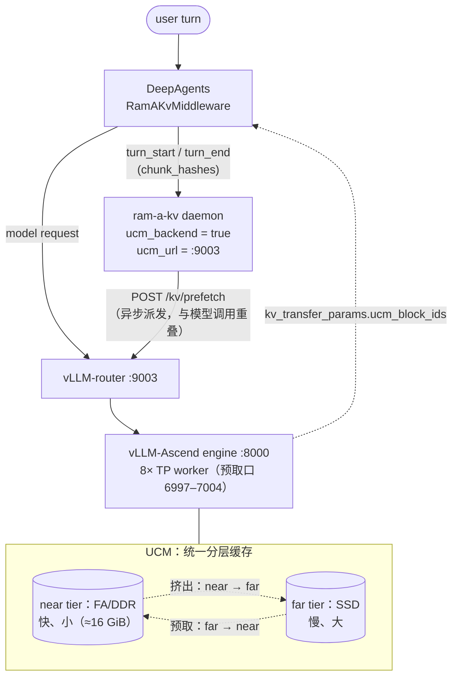

# DeepAgents × RAM-A:KV 预取收益实验

**摘要** — 本实验以真实的 [DeepAgents](https://docs.langchain.com/oss/python/deepagents) agent 会话为负载,量化 **ram-a-kv 预取**在「模型调用」与「整轮 agent 交互」两个口径上的时延收益。实验采用**两档对照**:近端(FA/DDR)容量小且被所有请求共享,一个会话的 KV 在其它请求持续写入下会被驱逐到 SSD,因此**默认(不预取)即为冷态**——预填充须从 SSD 回源;`prefetch` 则在 `turn_start` 把该会话 KV 拉回近端。在 **32k / 64k / 128k / 256k** token 四个上下文上,整轮加速比为 **1.10× → 1.36×**（token 数由引擎 `/tokenize` 真实校准，并经引擎回传 `prompt_tokens` 复核）。

***

## 1 背景与动机

多轮 agent 会话中,每一步推理的预填充阶段都需要把该会话的上下文 KV 从缓存层级读入显存。UCM 采用分层缓存:**近端(FA/DDR)容量小、带宽高**,其上为**远端(SSD)容量大、带宽低**。当一个会话的 KV 被后续流量挤出近端后,其预填充只能从 SSD 回源,直接抬高首 token 时延(TTFT)。

RAM-A 的预取机制在模型调用**之前**把该会话的 KV 块从 SSD 重新拉回近端,以把后续预填充的 `T_kv_load` 从「SSD 读」降为「DDR 读」。本实验的动机是:以真实 DeepAgents 负载为口径,**量化该机制在整轮 agent 交互上的端到端收益**,并给出一套可被第三方复现与审计的实验设计。

***

## 2 系统模型与原理

### 2.1 组件与数据流



- **模型调用**经 vLLM-router(:9003)转发至 vLLM-Ascend 引擎(:8000);该引擎启用了 UCM,故请求的 KV 由 UCM 分层缓存管理,响应因此携带 `kv_transfer_params.ucm_block_ids`。
- **middleware** 在模型调用前后,把 `turn_start` / `turn_end`(携带 `chunk_hashes`)上报 daemon。
- **daemon**(`ucm_backend`)在 `turn_start` 时判定是否预取该会话的块,并经同一 vLLM-router 扇出到 8 个 TP worker。

### 2.2 时延分解

一次 agent turn 的墙钟时延可分解为:

```
T_turn  ≈ T_agent + T_model
T_model ≈ T_queue + T_prefill + T_decode
T_prefill = T_compute + T_kv_load
```

其中与预取相关的仅有 **`T_kv_load`** —— 预填充阶段把该会话 KV 读入的过程:

```
T_kv_load = hits_near_tier ? T_ddr : T_ssd        (T_ssd ≫ T_ddr)
```

### 2.3 预取收益的构成

`turn_start` 预取在模型调用之前把该会话的块从 SSD 拉回近端,从而:

```
cold:      T_kv_load = T_ssd
prefetch:  T_kv_load = T_ddr,  代价是一次额外的扇出开销 C_fanout
```

单看模型侧,理想收益为 `Δ = T_ssd − T_ddr`。整轮是否获益,取决于 `C_fanout` 是否落在关键路径上:

```
整轮净收益 ≈ Δ − 未与模型调用重叠的 C_fanout
```

**ram-a-kv 以异步方式派发** **`turn_start`** **预取**:daemon 收到 `turn_start` 后立即返回,`/kv/prefetch` 的扇出在后台进行、与随后的模型调用**重叠**,故 `C_fanout` 基本被隐藏,整轮收益 ≈ `Δ`(见 §2.1 图)。本实验统一采用该异步模式(§4.4、§7 的 `TURN_START_ASYNC=1`)。

***

## 3 术语

| 术语                        | 定义                                           |
| ------------------------- | -------------------------------------------- |
| 近端 / near tier            | FA/DDR 缓存层,容量小、带宽高;本环境 FA ≈ 16 GiB           |
| 远端 / far tier             | SSD 缓存层,容量大、带宽低                              |
| turn                      | 一次 agent 交互:一次模型调用及其前后 middleware 上报         |
| `turn_start` / `turn_end` | middleware 在模型调用前/后向 daemon 上报的事件            |
| chunk / block             | KV 缓存块;本实验按引擎块 ≈ 128 token/块估算               |
| `Δ`                       | 单次预取省下的读取时延,`Δ = T_ssd − T_ddr`              |
| `C_fanout`                | daemon 经 vLLM-router 向 8 个 TP worker 扇出预取的开销 |
| `thread_id`               | 会话标识;每档测一次独立会话,避免前缀缓存串扰                      |

***

## 4 实验设计

### 4.1 研究问题

- 在真实 DeepAgents 会话上,预取能否降低整轮交互时延?收益的量级与随上下文的变化规律如何?

### 4.2 变量与响应指标

- **自变量**:预取开关(开 / 关)。
- **控制变量**:上下文规模(32k / 64k / 128k / 256k token)、`max_tokens`、`temperature`、探针 prompt、会话隔离、近端初始状态。
  - token 口径为**引擎回传的 `prompt_tokens`**(整条 prompt,含 DeepAgents 系统提示/探针/模板等固定脚手架)。生成器用引擎 `/tokenize` 真实校准材料长度,并按 `SCAFFOLD_TOKENS`(默认 2817)从目标中扣除该固定开销,使实测 `prompt_tokens` ≈ 目标(实测偏差 < 0.1%)。
- **响应指标**:

| 指标                | 定义                                            | 采集方式                                                       |
| ----------------- | --------------------------------------------- | ---------------------------------------------------------- |
| `latency_s`       | 整轮 `agent.invoke`(图调度 + middleware 上报 + 模型调用) | 用户实际感知的一次交互                                                |
| `model_latency_s` | 仅 chat 模型调用(预填充 + 解码)                         | LangChain callback(`on_chat_model_start` / `on_llm_end`)计时 |

`max_tokens=32`、`temperature=0` 固定,使生成段尽量短,把差异集中在预填充 / KV 读入。

### 4.3 对照组:两档设计

实验只对照两档——**不预取(基线)与**预取:

| 档位         | 近端(FA/DDR)状态          | daemon 预取 | 含义                 |
| ---------- | --------------------- | --------- | ------------------ |
| `cold`     | **冷**:会话 KV 已被挤出到 SSD | 关         | **基线**:预填充从 SSD 回源 |
| `prefetch` | 冷(同上)                 | 开         | 预取把该会话 KV 搬回近端     |

**为什么** **`cold`** **是默认状态**:近端(FA/DDR)容量小且被所有请求共享,一个会话的 KV 在其它请求持续写入下很快被驱逐到 SSD。因此对一个稍后再次访问该会话的 turn 而言,**近端为冷、预填充须从 SSD 回源是常态**,`cold` 即代表这一常态——无需额外构造「热」对照。

映射到 §2.2 的时延模型:

- `cold` ≈ `T_compute + T_ssd`(基准);
- `prefetch` ≈ `T_compute + T_ddr + 未重叠的 C_fanout`(理想情况下 ≈ `T_ddr`)。

### 4.4 实验流程

流程分三个阶段:`warm`(构建上下文)、`flush`(复现冷态)、`measure`(逐档测量)。

1. **warm(上下文构建)**:把起始 prompt 完整跑一遍,产生一次真实模型调用;`turn_end` 把该会话的 `chunk_hashes` 写入 daemon 会话表,并把整段上下文的 KV dump 到 SSD/DDR。对话消息序列保存为 `data/context_<thread>.json`,供后续原样复用。
2. **flush(复现冷态)**:用 UCM 预放池中的确定性长 prompt 重放若干条(`FLUSH_ENTRIES`,默认 16 条 ≈ 25.6 GiB),把近端挤出——等价于「被其它请求驱逐」,保证待测会话为冷态。
3. **measure(测量)**:将保存的上下文**原样重载**,拼接一个**固定 probe**,令 agent 重新推理:

| 档位         | 近端 flush | daemon 触发                        | 目的   |
| ---------- | -------- | -------------------------------- | ---- |
| `cold`     | 是        | `turn_start_prefetch=false`      | 基准   |
| `prefetch` | 是        | `turn_start_prefetch=true`(异步派发) | 待测收益 |

### 4.5 冷启动与近端挤出门槛

**必须 flush 的原因**:若近端在 warm 之后仍为热,则 `cold` 也会命中 DDR,两档差异被人为抹平。**需要的量**:挤出门槛 ≈ `1.2 ×` 近端容量。本引擎以 `UCM_CACHE_BUFFER_CAPACITY_GB=32` 启动,`FA = capacity/2 = 16 GiB`,门槛 ≈ **19.2 GiB**:

- 放 12 条(= 19.2 GB)恰好压在门槛上 ⇒ 是否淘汰**不确定**,冷态时有时无;
- 放 16 条(= 25.6 GB,一整组)留出约 33% 冗余 ⇒ 稳定复现冷态。

修改引擎容量后须同步调整 `FLUSH_ENTRIES`(≥ ⌈1.2 × FA / 1.6 GB⌉)。

***

## 5 运行环境与前置条件

1. **推理栈在运行**:vLLM-Ascend 引擎 `:8000`(启用 UCM)+ vLLM-router `:9003`,且 TP worker 预取口 `6997–7004` 已监听。
2. **ram-a-kv 已构建**:`cargo build --release`,`target/release/ram-a-kv` 存在。
3. **预放池存在**:`/mnt/sdb/ucm/flush_pool_64g.json`。
4. **Python 环境**:一个能 `import deepagents, langchain_openai, ram_a_middleware` 的解释器。脚本会自动探测,亦可用 `VENV_PY=` 显式指定。

***

## 6 复现指南

### 6.1 一键运行

在项目目录下执行(脚本自行探测 python 与 daemon 二进制):

```bash
cd ram-a-kv/tests/deepagent
SWEEP=32768,65536,131072,262144 REPS=3 MIN_SIZE=32768 HUMAN_TOKEN_LIMIT=1000000 ./run_deepagent_gain.sh
```

上面这条以及下文的 (A)–(D) 均为**非流式**(`streaming=false`,即默认)Chat Completions;如需**流式(SSE)**,加 `STREAMING=1`(见变体 (E))。

常用变体:

```bash
cd ram-a-kv/tests/deepagent

# (A) 四档扫描(推荐,主结果;非流式)
SWEEP=32768,65536,131072,262144 REPS=3 MIN_SIZE=32768 HUMAN_TOKEN_LIMIT=1000000 ./run_deepagent_gain.sh

# (B) 单尺寸、自定义长 prompt(文件传入,避免 argv 长度上限)
PROMPT_FILE=/path/to/prompt.txt REPS=3 ./run_deepagent_gain.sh

# (C) 短 prompt 内联传入
./run_deepagent_gain.sh "请总结预取如何降低首 token 时延?"

# (D) 不做冷 flush(更快;但近端仍热,两档差异被抹平)
FLUSH=0 SWEEP=65536 ./run_deepagent_gain.sh

# (E) 流式(SSE)Chat Completions:引擎把 kv_transfer_params 附在最后一个 chunk,
#     中间件模型适配层会保留该字段,故预取在流式下同样生效(见 §8.4)
STREAMING=1 SWEEP=131072 REPS=3 MIN_SIZE=131072 HUMAN_TOKEN_LIMIT=1000000 ./run_deepagent_gain.sh
```

> 测 >45k token 的上下文需放开单条消息上限:`HUMAN_TOKEN_LIMIT=1000000`(见 §7)。

### 6.2 输出产物

所有产物统一落在**单一输出目录** `data/`(可用 `DATA_DIR` 改名),运行完直接打开 **`data/RESULT.md`** 即可看到结果:

| 文件                                          | 内容                                           |
| ------------------------------------------- | -------------------------------------------- |
| **`data/RESULT.md`**                        | **结果速览:各尺寸的冷 / 预取平均时延 + 提升百分比 + 一句话结论**(首选)  |
| `data/results.jsonl`                        | 逐次原始记录(含 mode / size / rep / flushed / 两个时延) |
| `data/summary.json`                         | 按尺寸与档位聚合 + 收益比                               |
| `data/report.md`                            | 可直接引用的完整 markdown 汇总表(含环境指纹)                 |
| `data/run_env.json`                         | 本次运行的环境指纹                                    |
| `data/daemon.log`                           | daemon 日志                                    |
| `data/context_*.json` / `data/prompt_*.txt` | 各尺寸复用的上下文与 prompt                            |
| `data/sessions.db`                          | daemon 会话表                                   |

### 6.3 故障排查

| 现象                           | 可能原因                                          | 处理                                           |
| ---------------------------- | --------------------------------------------- | -------------------------------------------- |
| 两档几乎一致                       | 未冷启动(近端仍热)                                    | 确认 `FLUSH=1` 且 `FLUSH_ENTRIES × 单条大小 > 近端容量` |
| 同一尺寸两次结论不同                   | 引擎分钟级漂移(±10–15%)                              | 提高 `REPS`;跨运行合并(`APPEND=1`);取中位              |
| warm 的 `chunk_hashes` 很少或为 0 | prompt 被框架转存(超 200k 字符),或引擎未回 `ucm_block_ids` | 缩小 prompt;检查引擎 `kv_transfer_params`          |
| `prefetch` 方差很大              | 引擎 / worker 抖动或扇出偶发排队                         | 增大 `REPS`,观察中位与标准差                           |
| `port 7098 already in use`   | 存在残留 daemon                                   | 更换 `RAM_A_PORT`,或先停占用进程(脚本不会误用)              |
| 收益偏小                         | 上下文太小(小 KV 的改进空间小于噪声)                         | 增大 `SWEEP`;主结果从 ≥32k 起                       |

***

## 7 参数参考

| 变量                  | 默认                                 | 说明                                            |
| ------------------- | ---------------------------------- | --------------------------------------------- |
| `SWEEP`             | 空                                  | 多尺寸扫描的 token 列表,如 `32768,65536,131072,262144` |
| `PROMPT_FILE`       | 空                                  | 单尺寸模式的起始 prompt 文件                            |
| `MODEL_BASE_URL`    | `http://127.0.0.1:9003/v1`         | agent 访问的 OpenAI 兼容端点(建议指向 vLLM-router)       |
| `UCM_URL`           | `http://127.0.0.1:9003`            | daemon `ucm_url`,`/kv/prefetch` 目标            |
| `TOKENIZE_URL`      | `= UCM_URL`                        | 暴露引擎 `/tokenize` 的基址,用于真实校准 prompt token 数       |
| `SCAFFOLD_TOKENS`   | `2817`                             | 固定脚手架 token(system+探针+模板),从每个目标尺寸扣除;置 0 则直接按材料长度 |
| `RAM_A_PORT`        | `7098`                             | daemon 端口,**勿用 6997–7004**(UCM worker 预取口)    |
| `THREAD_ID`         | `deepagent-gain`                   | 单尺寸模式的会话 id                                   |
| `REPS`              | `3`                                | `{cold, prefetch}` 的重复次数(报告取中位)               |
| `TURN_START_ASYNC`  | `1`                                | turn\_start 预取异步派发(扇出与模型调用重叠);置 0 为同步等待,仅诊断用  |
| `STREAMING`         | `0`                                | 置 1 使用流式(SSE)Chat Completions;引擎在最后一个 chunk 回传 `kv_transfer_params`,中间件保留之,预取同样生效(见 §8.4) |
| `FLUSH`             | `1`                                | 每次 measure 前是否 flush 近端为冷                     |
| `FLUSH_POOL`        | `/mnt/sdb/ucm/flush_pool_64g.json` | UCM 预放池                                       |
| `FLUSH_ENTRIES`     | `16`                               | 每次 flush 重放的池条目数(须 > \~1.2×FA,见 §4.5)         |
| `PROBE`             | `请用一句话复述上文的核心要点。`                  | 附加在上下文之后的固定探针                                 |
| `HUMAN_TOKEN_LIMIT` | `0`                                | >0 时放宽单条消息淘汰阈值(测 >45k token 必需,如 `1000000`)   |
| `DATA_DIR`          | `<脚本>/data`                        | 单一输出目录:所有产物(结果、报告、日志、上下文)都在此                  |
| `MIN_SIZE`          | `0`                                | report 仅展示 ≥ 该 token 数的尺寸(主结果从 32768 起)       |
| `VENV_PY`           | 自动探测                               | 含 deepagents 的 python                         |
| `DAEMON_BIN`        | `<repo>/target/release/ram-a-kv`   | daemon 二进制                                    |
| `KEEP_DAEMON`       | `0`                                | 置 1 则结束后不杀 daemon                             |
| `APPEND`            | `0`                                | 置 1 则保留已有 `results.jsonl`(增量运行 / 事后提高 `REPS`) |

***

## 8 实验结果

> **统一条件**:单条 human 起始 prompt、`max_tokens=32`、`temperature=0`、异步 turn\_start 预取、daemon 走 `ucm_backend`;**非流式**(`streaming=false`,默认)Chat Completions;每次 `cold` / `prefetch` 前 flush 16 条池条目(§4.5)。`REPS=3`、`HUMAN_TOKEN_LIMIT=1000000`。原始数据在 `data/`(§8.4 流式复测在 `data/streaming/`)。

### 8.1 主结果:上下文 32k / 64k / 128k / 256k(RQ1)

命令 `SWEEP=32768,65536,131072,262144 REPS=3 MIN_SIZE=32768 HUMAN_TOKEN_LIMIT=1000000 ./run_deepagent_gain.sh`。下表 `目标tok` 为配置目标;`实测tok` 为引擎回传的 `prompt_tokens`(整条 prompt,含固定脚手架),两者偏差 < 0.1%。

**两档平均时延(mean,s;每格 n=3)**

| 目标tok  | 实测tok  | cold 整轮 | prefetch 整轮 | cold 模型 | prefetch 模型 |
| ------ | ------ | ------- | ----------- | ------- | ----------- |
| 32768  | 32764  | 1.149   | 1.049       | 1.108   | 1.011       |
| 65536  | 65557  | 1.520   | 1.307       | 1.478   | 1.265       |
| 131072 | 131092 | 1.889   | 1.468       | 1.848   | 1.425       |
| 262144 | 262109 | 3.324   | 2.447       | 3.278   | 2.404       |

**收益(相对** **`cold`** **基准)**

| 目标tok  | 整轮收益      | 模型收益      | 模型省时(ms) |
| ------ | --------- | --------- | -------- |
| 32768  | 1.096     | 1.096     | 97       |
| 65536  | 1.163     | 1.168     | 213      |
| 131072 | 1.287     | 1.297     | 423      |
| 262144 | **1.358** | **1.363** | **874**  |

**判读**:

- **两档在四个尺寸上稳定分离**:`prefetch` 一致快于 `cold`,整轮与模型两层口径高度一致。
- **上下文越大收益越大**:32k → 8.7%,64k → 14.0%,128k → 22.3%,256k → **26.4%**。
- **256k 最显著**:`cold`(3.324 s)比 `prefetch`(2.447 s)慢 0.88 s,SSD 回源在冷态总时长中的占比随 KV 体积增大而上升。

### 8.2 收益随上下文的变化

| 目标tok  | 整轮收益      | 模型收益      |
| :----- | :-------- | :-------- |
| 32768  | 1.096     | 1.096     |
| 65536  | 1.163     | 1.168     |
| 131072 | 1.287     | 1.297     |
| 262144 | **1.358** | **1.363** |

- 收益随上下文**单调上升**(+8.7% → +26.4%),绝对省时随 KV 体积增长(97 → 874 ms)。

**机制**:`speedup = 1/(1 − Δ/T_cold)`,分子为省下的 SSD 读取 `Δ ∝ KV 体积`;`T_cold` 中的**预填充计算**随 token 同阶增长,稀释了比值,故收益比不会无限放大,而是随上下文增大**稳步上升**。

绝对省时(ms)始终 ∝ KV 体积、随上下文增长(97 → 874 ms),此即大上下文收益更高的根源。

### 8.3 各阶段时间轴:预取如何被模型调用「掩盖」(以 128k 为例)

把一次真实 turn 的四层(客户端 → 网关 → 引擎各阶段 → SSD 加载 → 预取)放在**同一墙钟轴**上。四层日志时钟均为 UTC,可直接对齐。

> **口径**(重要):
> - **实测**:客户端 `results.jsonl` 的 `measure_start/model_start/model_end_epoch`;引擎 FAWA 行(墙钟 + `chatcmpl` id);daemon `daemon.log` 的 `turn_start` / `UCM prefetch response`。
> - **聚合均值**:`/metrics` 的 `vllm:request_*`、`ucm:cache_load_duration_ms`、`vllm_router_generate_duration_seconds` —— 引擎/网关**自启动以来**的全局直方图(**非单请求**),此处仅作量级参考。
> - **估计**:128k 的 daemon 逐请求预取窗口未留存(见 §8.3.4),按 256k 实测窗口 × blocks 比例折算。

#### 8.3.1 单次 128k turn 的四层锚点(实测)

以 `prefetch` 档 rep1 为例(引擎 request `chatcmpl-a6e8d14e28a1ccfb…`,`prompt_tokens=131092`):

| 层 | 锚点事件 | UTC 墙钟 | 相对 `model_start` | 来源 |
| --- | --- | --- | --- | --- |
| client | `measure_start`(turn 起点) | 10:44:03.586699 | −33.8 ms | results.jsonl |
| daemon | 收到 `turn_start` → 异步派发预取 | ≈ 10:44:03.616 | ≈ −4 ms | daemon 机制(§8.3.4) |
| client | `model_start`(`POST /v1/chat/completions` → 网关) | 10:44:03.620538 | 0.0 ms | results.jsonl |
| engine | FAWA:命中外部 KV(connector lookup) | 10:44:04.273211 | **+652.7 ms** | 引擎日志 |
| client | `model_end`(32 tok 解码完毕返回) | 10:44:05.000258 | **+1379.7 ms** | results.jsonl |

整轮 `measure_start → model_end` = **1413.6 ms**;其中模型调用 `model_start → model_end` = **1379.7 ms**(= `model_latency_s`)。

#### 8.3.2 时序图(相对 `model_start`)

```text
 相对 model_start(ms)   0                     652.7                            1379.7
                        |                       |                                 |
 [client] model 调用     +---------- 模型调用 1379.7 ms -------------------------+
                        |                       |                                 |
 [engine] (A) + (C)      +- (A) 网关路由+在途+调度+lookup ≈653ms -+- (C) KVload+预填充+解码32tok ≈727ms -+
                        |                       ^ FAWA:外部 KV 命中 131072
 [daemon] 预取(后台)     +== SSD→DDR 1024 blocks ≈635 ms ==+     <- 完全落在模型窗口内 => 被掩盖
                        |                       |
 [UCM]     近端/远端      SSD ====> DDR(1024 blocks)  =>  近端就绪,预填充免于 SSD 回源
```

#### 8.3.3 冷 / 预取两档的分段耗时(128k,rep=3 均值)

| 分段 | cold | prefetch | 差 |
| --- | --- | --- | --- |
| (A) `model_start → FAWA`(网关路由+在途+调度+lookup) | 709 ms | 692 ms | ≈0 |
| (C) `FAWA → model_end`(KV load + 预填充 + 解码 32 tok) | **1139 ms** | **733 ms** | **−406 ms** |
| 模型调用 `model_start → model_end` | 1848 ms | 1425 ms | −423 ms |
| 整轮 `latency_s` | 1889 ms | 1468 ms | −421 ms |

关键点:

- 两档 **(A) 段几乎相同**(709 vs 692 ms):网关路由、引擎在途、调度、UCM lookup 与是否预取无关。
- 差异**全部落在 (C) 段**(−406 ms ≈ Δ):预取把 `T_kv_load` 从「SSD 读」变成「DDR 命中」。
- (C) 段差(−406 ms)与模型调用差(−423 ms)在噪声内一致 ⇒ 预取收益即 `Δ = T_ssd − T_ddr`,无其它副作用。

补充(**聚合均值,非单请求**):UCM 单次加载 `ucm:cache_load_duration_ms`(worker_rank0,count=1999)均值 ≈ **575 ms**;网关 `vllm_router_generate_duration_seconds` 均值 ≈ **2.73 s**(全量 981 请求,含 32k–256k 混合)。网关自身为 `consistent_hash` **查表路由**(亚毫秒),其「占时」主要是**透传引擎流式推理**,对 128k 单请求 ≈ 模型调用 1379.7 ms。

#### 8.3.4 预取窗口为何「被掩盖」

`daemon.log` 每次运行被覆盖,当前仅保留**最后一次 256k** 的**逐请求**预取窗口;128k 的 daemon 窗口未留存,但机制相同。以 256k 实测窗口佐证:

| 量(256k,`prefetch`,`deepagent-gain-262144`) | 值 |
| --- | --- |
| `turn_start` 收到 | 10:52:51.784876 |
| `UCM prefetch response`(8×worker 扇出完成) | 10:52:53.054112 |
| **预取窗口** | **1269 ms**(2047 blocks/rank) |
| `model_start` | 10:52:51.786548 |
| FAWA(外部 KV 命中) | 10:52:53.292072(+1506 ms) |
| `model_end` | 10:52:54.252785(+2466 ms) |

预取窗口 `[0, 1268 ms] ⊂ 模型窗口 [0, 2466 ms]`,且比 FAWA(+1506 ms)**早 238 ms** 完成——**预取全程与「网关+在途+调度」重叠,不占关键路径**。

按 blocks 比例折算到 128k:`1269 ms × 1024/2047 ≈ 635 ms`,恰好落在 (A) 段(≈653 ms)内、并在 FAWA(+652.7 ms)前完成——这正是 (A) 段两档耗时相同、(C) 段省下 ≈406 ms 的原因。

**一句话**:预取耗时 ≈ **635 ms** 被完全隐藏在模型调用 **1379.7 ms** 之内(准确地讲,藏在 FAWA 之前的 (A) 段里),故整轮收益 ≈ `Δ ≈ 0.42 s`,与 §8.1 实测一致。

> 上面的窗口与「按 blocks 折算」均属推断;§8.3.5 改用引擎侧细粒度打点直接实测,实测预取窗口 ≈ 376–382 ms,结论方向一致、余量更大。

#### 8.3.5 流程时延细粒度拆解(实测,n=3)

§8.3.1–8.3.4 的分解建立在**四个锚点**(client / daemon / FAWA 日志 / UCM 聚合直方图)与**按 blocks 比例折算**之上:daemon 只记录 `turn_start` 与 `prefetch response` 两个时刻,引擎侧只有一条 `logger.info_once` 的 `FAWA` 日志,既没有逐请求、也没有逐 rank 的分段。为把「谁占了多少毫秒」从推断变为实测,在 UCM 侧加了可开关的阶段打点:设置 `UCM_STAGE_TRACE_FILE=<path>.jsonl` 即开启,未设置时**零开销**;引擎 9 个进程(1 个 EngineCore + 8 个 TP worker)各自 `O_APPEND` 写同一份 JSONL。

**事件字典**

| 事件 | 产生位置 | 关键字段 | 含义 |
| --- | --- | --- | --- |
| `prefetch_recv` | 各 TP worker 的预取 HTTP 服务 | `ts` / `rank` / `blocks` | 该 rank 收到 daemon 发来的 `/kv/prefetch` |
| `prefetch_warm` | 同上 | `warm_ms` / `lock_wait_ms` | 该 rank 的 SSD→DDR 预热耗时,以及在 rank 内的排队等待 |
| `prefetch_resp` | 同上 | `total_ms` | 该 rank 从 recv 到返回响应 |
| `lookup` | 引擎 rank0(connector) | `age_ms` / `lookup_ms` / `ext_hit_blocks` / `hbm_hit_blocks` / `tokens` | `age_ms` = 请求**到达引擎**→connector 查表完成(含网关在途、排队与调度);`lookup_ms` 为查表本身 |
| `load_submit` / `load_done` | 各 TP worker | `label`(FA/WA) / `blocks` / `wait_ms` / `ok` | DDR→HBM 的提交与等待 |
| `req_finished` | 引擎 rank0 | `age_ms` / `tokens` | 请求结束;`age_ms` 为到达→结束总时长 |

**口径**(容易踩的两个坑):

- 8 个 TP rank **各自**上报 `load_done`,FA/WA 的加载在 rank 间**并行**,关键路径取各 rank 的**最大值**而非求和(求和会得到 8 倍的假象);
- `lookup` 只由 rank0 产生(其余 rank 拿广播结果),故它不代表 8 rank 之和。

**实测:128k 逐请求分段(三对 cold / prefetch,中位数 ms)**

| 分段 | cold | prefetch | 差 |
| --- | --- | --- | --- |
| 整轮 `latency_s` | 1997.0 | 1594.1 | **−402.9**(1.253×) |
| 模型调用 | 1953.2 | 1555.7 | **−397.5** |
| 网关 + 在途(0 → 到达引擎) | 23.9 | 24.4 | +0.5 |
| 到达 → lookup 完成 | 686.5 | 722.3 | +35.8 |
| lookup 本身 | 11.5 | 9.7 | −1.8 |
| **KV load(FA,8 rank 最大)** | **445.4** | **55.9** | **−389.5** |
| KV load(WA) | 0.04 | 0.03 | ≈0 |
| 尾段(预填充计算 + 解码 32 tok) | 795.3 | 728.0 | −67.3 |

> 逐列为各自中位数,`尾段` 由每次 `模型调用 − 到达→lookup − lookup − load` 逐条算出后再取中位,故各列相加与整轮有 ~10 ms 级舍入差;`load` 取 8 rank 最大值。

**一次 turn 的时间轴(取各档中位时延的那次,相对 `model_start`)**

```text
相对 model_start(ms)   0        24                         747  845              1556
                       |         |                           |    |                 |
[client] 模型调用       +----------- 1555.7 ms ------------------------------------+
[engine] 到达引擎                  +                           |                    |
         lookup 完成(722.3)                                    +                    |
         KV load 55.9ms(DDR)                                        +               |
         req_finished                                                       +1545.9 |
[daemon] 预取 fanout    +== 381.5 ms (8 rank 并行, 1024 blocks/rank) ==>          |
[UCM]    SSD ===> DDR   ^ 在 +384.7 ms 完成,比 lookup 完成早 362 ms                |
```

同一次对照的 `cold` 档:到达 +23.9 ms、lookup 完成 +710.4 ms、`KV load 427.1 ms` 结束于 +1175.6 ms、`req_finished` +1944.4 ms。两档在「到达 → lookup」段基本重合(710.4 vs 746.7 ms),差别集中在 `KV load` 之后的 +430 ms。

**并行时间轴:推理请求 与 预取 fanout 怎么重叠(同一次 turn 实测)**

先明确一点:预取**不是另一次推理请求**,而是 daemon 向 8 个 TP worker 的预取服务发起的 HTTP fanout,只做 **SSD→DDR**(`warm`),既不进调度队列、也不搬 HBM。推理请求此刻还在 `frontend` 进程里做 **chat 模板渲染 + 131k prompt 分词**(vLLM 的 `arrival_time` 打在渲染/分词**之前**,见 `vllm/renderers/base.py`)。两者的并行是**进程级**的:

```text
t (ms, 相对 model_start)   0     2        24                          747  781  845          1546
                           |     |        |                            |    |    |             |
client/middleware  ────────● 发模型请求
daemon             ────────●─┐ 异步 fanout(不等响应)
worker×8 (SSD→DDR) ──────────┴══ warm 381.1~381.7 ms ══╡ resp 383.9~384.5
frontend (CPU)     ────────●(24)════ chat 模板 + 分词 131k ≈ 690 ms ════●(747)
engine core        ───────────────────────────────────────────────────●(747)─●(781)─●(845)
                                                                     lookup 9.7  submit  FA load 61.5
engine core        ─────────────────────────────────────────────────────────────[ prefill 845→ + decode ]→1546
                     ↑ 预取结束(384.5)到 lookup(746.8)之间有 362 ms 空窗:已预热完,纯排队
```

| 时间窗(ms) | 推理侧在做什么 | 预取侧在做什么 | 是否相互影响 |
| --- | --- | --- | --- |
| 0 – 24 | client → router → frontend,`arrival_time` 打点 | daemon 异步派发;8 个 rank 在 **1.9–2.4 ms** 内全部收到 | 否(不同进程) |
| 24 – 385 | 模板渲染 + 分词 + 入 EngineCore 队列 | 8 rank 并行 `warm` 1024 blocks/rank,384.5 全部返回 | 否:`warm` 只占 **CPU + SSD 读 + /dev/shm 写**,此时 8 个 worker 无 batch |
| 385 – 747 | 排队 / 首次调度(362 ms 空窗) | 已结束,DDR 中已有副本 | 否 |
| 747 – 845 | `lookup` 9.7 ms → 提交 load → `FA load` 61.5 ms(DDR→HBM) | 已结束 | 是:`load` 直接读刚才预热好的 DDR 副本 |
| 845 – 1546 | 分块预填充计算 + 解码 32 tok | — | — |

8 个 rank 的预取时序(同一次 turn):

| rank | recv(ms) | warm(ms) | resp(ms) |
| --- | --- | --- | --- |
| 0 | 1.87 | 381.7 | 384.1 |
| 1 | 2.24 | 381.7 | 384.5 |
| 2 | 2.32 | 381.7 | 384.5 |
| 3 | 2.20 | 381.7 | 384.5 |
| 4 | 2.17 | 381.2 | 383.9 |
| 5 | 2.41 | 381.1 | 384.1 |
| 6 | 2.36 | 381.2 | 384.1 |
| 7 | 2.25 | 381.4 | 384.1 |

与之对照,`cold` 档同一请求:`lookup` 结束于 +710.4 ms,`FA load`(427.1 ms,SSD)结束于 +1175.6 ms —— 也就是说两档**唯一错开的就是 385→1176 ms 这一段**:预取档在这里只花 61.5 ms(DDR),冷档花 427.1 ms(SSD)。

**为什么能藏住**:① daemon 异步派发,客户端不等 `turn_start` 的响应;② `warm` 与推理此时用的资源不重叠(SSD/DDR 写 vs CPU 分词);③ 真正需要 HBM 的 `load` 被排在 `lookup` 之后,而那时 `warm` 早已结束(362 ms 余量),不存在「边加载边等预热」。

**代价与边界**:能藏住的前提是「到达 → lookup」窗口(本例 690 ms)长于 `warm`(≈382 ms)。若 prompt 更短、或引擎几乎不排队,该窗口可能缩到 100–200 ms,`warm` 就会露头,收益退化为 `Δ_load − 未隐藏部分`;若 8 个 worker 此刻正有 batch 在跑,`warm` 还会与推理抢 SSD/DDR 带宽。因此 §8.3.5 的 402.9 ms 是**长 prompt、近空载**下的最好情况。

**预取 fanout(每次 turn_start 一次,8 个 rank 全部到达)**

| 次 | blocks/rank | 到达 rank 数 | recv → 最晚 resp(ms) | warm min / med / max(ms) | lock_wait max(ms) |
| --- | --- | --- | --- | --- | --- |
| 1 | 1024 | 8 | 377.3 | 375.2 / 376.1 / 376.9 | 0.005 |
| 2 | 1024 | 8 | 382.6 | 381.2 / 381.5 / 381.9 | 0.005 |
| 3 | 1024 | 8 | 382.7 | 381.1 / 381.5 / 381.7 | 0.005 |
| 4 | 1024 | 8 | 372.3 | 371.0 / 371.3 / 371.6 | 0.004 |

- 8 个 rank 的 `prefetch_recv` 在 **0.5 ms** 内齐到(说明 router 扇出本身近乎无耗时),`warm` 各 rank 差异 < 7 ms,`lock_wait` ≈ **0**(rank 内无排队);
- `warm ≈ 376 ms` 对应 1024 blocks/rank(≈0.8 GB/rank),折算单 rank 带宽 ≈ 2.2 GB/s,8 rank 合计 ≈ 17.5 GB/s。

**结论修正(相对 §8.3.4)**

1. **预取窗口实测 ≈ 376–382 ms**,而不是按 blocks 折算的 635 ms;§8.3.4 里「635 ms 恰在 (A) 段内」的估算是**保守的**,实际余量更大。
2. 预取在 **+384.7 ms** 完成,比 lookup 完成(**+746.7 ms**)早 **362 ms**,完全落在「前端模板渲染 / 分词 + 入队调度」窗口内(该窗口不含任何 KV 搬运);两档该段实测 686.5 vs 722.3 ms(diff 36 ms,与引擎抖动同量级),**证实预取不占关键路径**。
3. **收益主体是 `KV load`**:FA 从 **445.4 ms(SSD)降到 55.9 ms(DDR)**,Δ ≈ **390 ms**,占模型调用省时(397.5 ms)的 **98%**。WA 只加载每个前缀边界的 tail(实测 **1 个 block**、0.03 ms),预取未覆盖 WA 也**无实质影响**——这也印证了 §8.3.4 对 FA/WA 的判断。
4. **尾段差不稳定**(三次配对分别为 −94 / −68 / +5 ms):说明冷档除了在 `wait_load` 里等 SSD 之外,预填充流水线上只残留零到几十毫秒的抖动,不构成机制性差异;其余差额应计入引擎抖动而非预取副作用。
5. 由 2、3 得单轮净收益 ≈ `Δ_KV_load − 0` ≈ **390 ms**,与整轮实测 **402.9 ms**(含 ~13 ms 客户端/middleware 抖动)一致。

**复现**

```bash
# 1) 起引擎(容器内):UCM 指向打了点的副本,并打开 trace
export PYTHONPATH=/home/xtc/ucm/unified-cache-management-analyze:$PYTHONPATH
export UCM_STAGE_TRACE_FILE=/mnt/sdb/ucm/<dir>/ucm-stage-trace.jsonl
UCM_CACHE_BUFFER_CAPACITY_GB=32 VLLM_MAX_MODEL_LEN=262144 ./start-tp8.sh up

# 2) 128k 冷 / 预取各 3 次
SWEEP=131072 REPS=3 MIN_SIZE=131072 HUMAN_TOKEN_LIMIT=1000000 FLUSH=1 \
  VENV_PY=/opt/miniconda3/envs/ram-a-agent/bin/python \
  DATA_DIR=$PWD/data/trace-131k ./run_deepagent_gain.sh

# 3) 汇总:两档分段中位数 + 每次 fanout 的 8 rank 明细 + 逐请求表
python3 benchmarks/stage_trace_report.py \
  --trace /mnt/sdb/ucm/<dir>/ucm-stage-trace.jsonl \
  --client data/trace-131k/results.jsonl
```

- 打点只改 Python(connector / 预取服务 / 报告脚本),重启引擎即生效,无需重编译 UCM;关闭只需不再导出 `UCM_STAGE_TRACE_FILE`。
- 本例数据:`data/trace-131k/`(客户端 `results.jsonl`、`daemon.log`);JSONL 与汇总报告在 `/mnt/sdb/ucm/deepagent-trace-20261028-191059/`(`ucm-stage-trace.jsonl`、`report.md`)。trace 里还包含 flush 用的 16 条 250k 级请求(1959 blocks/rank),可作为「大 KV 量」的对照。
- **局限**:n=3、单会话、单卡视角(TP8 全卡);`REPS` 越大越稳。分段中位为逐次配对后取中位,样本量小,毫秒级差异不宜过度解读。

#### 8.3.6 引擎内实测:从 `t=0` 起的两条路径(前端/哈希/查表全打点)

§8.3.5 给的是**中位数**和「拼图」;§8.3.6 的上一版只能把「chat 编码 / 分词 / 哈希 / IPC」标成**同机离线实测**,并把最后 ≈240 ms 记为「由总时长反推的残差」。本节把这几段也做成**引擎内打点**,用真实 TP8 引擎的一轮推理把离线值与残差全部替换掉。

**打点装置**(三处,全部默认零开销,只有导出 `UCM_STAGE_TRACE_FILE` 才落盘)

| 事件 | 位置 | 语义 |
| --- | --- | --- |
| `render_txt` / `render_done` | `vllm/vllm/renderers/base.py` 的 `render_chat` / `render_chat_async` | `arrival_time` 起点、chat 编码 + 分词结束(带 `tokens`) |
| `hash_start` / `hash_done` | `vllm/vllm/v1/engine/core.py` 的 `preprocess_add_request` | `Request.__init__` + block 链式哈希 前后 |
| `lookup` / `load_submit` / `load_done` / `req_finished` / `prefetch_*` | `ucm/integration/vllm/stage_trace.py`(analyze 副本) | 连接器查表 / KV 加载 / 预取 |

- 引擎:`归档/real-test/start-tp8.sh`,TP8/DP1,dies 4–11,`--block-size 32`,`--max-model-len 262144`,UCM DDR 32 GB,`--max-num-batched-tokens 10240`;
- 模型 `DeepSeek-V4-Flash-0731-w8a8`,prompt 固定 **131092 token**(`SWEEP=131072` + 2817 token scaffold);
- 打点原始文件:`/mnt/sdb/ucm/deepagent-trace-live2/stage-trace.jsonl`;客户端锚点:`data/trace-live5/results.jsonl`(n=3)与 `data/trace-live4/results.jsonl`(单 turn 表取自这一轮);
- `t=0` 一律取**该档自己的客户端 `model_start_epoch`**,所以 `arrival` ≈ +25 ms(含网关与在途);
- 下文「单 turn」列:同一行的分项相加**严格等于** `age_ms`,用于自洽展示;「n=3 中位」列:3 次重复各自取中位,列内**不同行相加不等于 `age`**(各差几 ms),用于看稳健性。

**A. 预取路径(daemon → router → 8 个 TP worker 的预取服务)**

请求 `chatcmpl-b922126858962eb3-9ace824c` 所属 turn 的预取侧事件,`t0 = 1793222602.750203`(比 `model_start` 晚 **+1.8 ms**:中间件先异步派发 turn_start,再去调模型)。

| 阶段 | 单 turn t(ms) | n=3 中位(ms) | 打点 |
| --- | --- | --- | --- |
| 8 个 rank 收到预取请求 | 0.0(t0 = model_start +1.8) | t0 = +1.5 ~ +2.0 | `prefetch_recv` ×8 |
| 各 rank 完成 SSD→DDR | **+374.9** | warm 结束 **+371.4**(warm_ms 中位 **371.8**,区间 370.7–373.7) | `prefetch_warm` ×8 |
| 8 个 rank 返回响应 | **+375.3** | resp 结束 **+371.7** | `prefetch_resp` ×8 |

预取整条路径 **≈375 ms**,其中 99.9% 是 8 rank 并行的 `warm`(1024 blocks/rank ≈ 0.79 GB/rank),扇出与回包各 <1 ms,`lock_wait` ≤0.005 ms(rank 内无排队)。与上一版(383 ms)一致。

**B. 推理路径(单 turn,cold / prefetch 并列,t=0 为各自 `model_start`)**

| 阶段 | prefetch t(ms) | cold t(ms) | 打点 |
| --- | --- | --- | --- |
| 到达引擎(`arrival_time`) | **+25.2** | **+23.6** | `render_txt` |
| chat 编码 + 分词完成 | **+544.1** | **+503.3** | `render_done` |
| 进入 EngineCore(开始构造 `Request` + 哈希) | +558.1 | +518.4 | `hash_start` |
| 4096 块哈希完成 | +726.9 | +689.0 | `hash_done` |
| `lookup` 完成(connector 查表返回) | **+747.9** | **+713.1** | `lookup` |
| `load_submit`(8 rank 首个) | +784.8 | +753.6 | `load_submit` |
| `FA load_done`(8 rank 最早) | **+867.3** | **+1169.7** | `load_done` |
| `req_finished` | +1586.4 | +1960.6 | `req_finished` |
| 客户端收到响应(`model_end`) | +1607.9 | +1984.5 | `results.jsonl` |

**C. 「到达 → lookup」窗口拆解(替换上一版的离线值与 240 ms 残差)**

| 子阶段 | cold 单 turn | prefetch 单 turn | n=3 中位 cold / prefetch | 口径 |
| --- | --- | --- | --- | --- |
| 到达 → `render_done`:chat 编码 + 分词(131092 tok) | **479.7 ms** | **518.9 ms** | **506.5 / 553.4 ms** | 引擎内 |
| `render_done` → `hash_start`:前端序列化 + ZMQ `ipc://` + 输入线程入队 | 15.1 ms | 14.0 ms | 14.6 / 14.0 ms | 引擎内 |
| `hash_start` → `hash_done`:`Request.__init__` + 4096 块链式 `tuple+pickle+sha256` | **170.6 ms** | **168.8 ms** | **168.7 / 167.8 ms** | 引擎内 |
| `hash_done` → `lookup`:本地前缀查找 + 调度步进 + UCM 查表 | 24.1 ms | 21.1 ms | 21.4 / 18.9 ms | 引擎内 |
| 其中 UCM 外部查表 `lookup_ms` | 13.0 ms | 11.6 ms | 13.1 / 12.0 ms | 引擎内 |
| **合计 到达 → `lookup`(`age_ms`)** | **689.4 ms** | **722.7 ms** | **711.5 / 756.0 ms** | 引擎内 |

旧版的「≈240 ms 反推残差」到这里被拆成两段实测量:**哈希 168.7 ms + 入队/查表 21.4 ms**。同时暴露出一个反直觉事实:同机离线基准测的「4096 块哈希 = 11.0 ms」**低了 15 倍** —— 离线基准是空载独立进程,引擎内该线程要跟引擎步进线程、8 个 worker 抢 CPU,单块成本从 2.7 µs 涨到 41 µs。这也印证了「离线基准只能量级参考,不能用于线上定量」。

**D. `lookup` 之后的阶段**

| 区间 | cold 单 turn | prefetch 单 turn | n=3 中位 cold / prefetch |
| --- | --- | --- | --- |
| `lookup` → `load_submit` | 40.6 ms | 36.9 ms | 35.6 / 37.0 ms |
| `load_submit` → FA 完成(8 rank 最早) | **416.1 ms** | **82.5 ms** | **417.5 / 81.8 ms** |
| FA 完成 → `req_finished`(prefill 131k + decode 32) | 790.9 ms | 719.1 ms | 725.0 / 716.0 ms |
| 模型全程(`model_latency`) | **1972.5 ms** | **1596.1 ms** | **1923.1 / 1626.9 ms** |
| 整轮(`turn`) | 2016.8 ms | 1645.6 ms | 1968.2 / 1673.5 ms |

**E. 合并时间轴(t=0 起;`cold / prefetch` 并列)**

```text
t(ms)     0      25        503/544     689/727   713/748  754/785     867/1170        1586/1961 1608/1985
          |       |            |           |         |        |            |                |        |
client    ●──────────────────────────────────────────────────────────────────────────────────────────────●
daemon    ●─┐ turn_start 异步派发(+1.8)
worker×8    └══ warm 370.7~373.7 ══╡ resp 375.3       ← 预取在 +375 就干完了,后面全被藏住
engine    ──● 到达(+25)─ 分词(480/519) ─ 入队(15/14) ─ hash(171/169) ─ 查表(24/21) ─●(713/748)─●(754/785)
                                                                                        │
cold      ───────────────────────────────────────────────────── FA 416 ← SSD ──────────●(1170)── prefill+decode 791 ──●(1961)
prefetch  ───────────────────────────────────────────────────── FA  82 ← DDR ──────────●( 867)── prefill+decode 719 ──●(1586)
                                                                      ↑
                                                        两档唯一实质差异:416 → 82 ms(Δ334)
```

**关键读数**

1. **分词仍是第一大户**:n=3 中位 506.5 ms(cold),占「到达 → lookup」窗口 711.5 ms 的 **71%**;哈希第二 168.7 ms(**24%**);两者合计 **95%**,UCM 查表只有 12–13 ms(1.7%)。
2. **旧版的「240 ms 残差」实测就是 block 哈希**:引擎内 `Request.__init__` + 4096 块链式哈希 **168.7 ms**,另有入队/IPC 14.6 ms、查表与调度 21.4 ms。
3. **预取会轻微拖慢分词**:同一次运行里 prefetch 档分词中位 553.4 ms,比 cold 档 506.5 ms 长 **46.9 ms(+9.3%)**;3 轮区间(cold 486–568、prefetch 549–565)有重叠,只能定性为「疑似 CPU/内存带宽争抢」,量级 ≤50 ms。
4. **收益口径要对齐到端到端**:FA 加载 `417.5 → 81.8 ms`(Δ **335.7 ms**),但端到端 `model` 只省 `1923.1 → 1626.9 = 296.2 ms`;差的 ≈40 ms 正好被第 3 条的分词变慢吃掉。**只看 FA 段会高估 13%。**
5. **预取依旧完全被隐藏**:预取在 +375 ms 完成,引擎 +748 ms 才查完表、+785 ms 才发起 KV 加载,**余量 410 ms**,一次都没被等过。
6. 两档窗口差 44.5 ms(711.5 vs 756.0),几乎全部来自分词抖动(506.5 vs 553.4),与 KV 冷热无关 —— 与上一版结论一致。
7. **踩坑提醒**:`HUMAN_TOKEN_LIMIT` 默认 0(中间件按 50000 淘汰),131k 的 human 消息会被替换成文件引用,实测请求只剩 **3156 token**,跑出来「收益 1.003×」。测 >45k 必须显式 `HUMAN_TOKEN_LIMIT=200000`。

**局限**

- 两档是**不同 turn**,不是同一请求的 A/B;每档重复 3 次取中位,单 turn 表只用于「分项相加 = age」的自洽展示。
- 打点是每次一条 `os.write`(实测 <0.1 ms/事件),对结论无影响;`render_*` 与 `hash_*` 两处新增打点目前只在本机 vllm 源码与 UCM analyze 副本里,未进主干,复现时需带上这两处改动。
- 宿主机 dies 0–3 被其他租户占用(本次只用 4–11),绝对时延会随邻居负载波动,但**同一次运行内**的 A/B 对比不受影响。
- 复现命令(容器内):

```bash
UCM_STAGE_TRACE_FILE=/mnt/sdb/ucm/trace/stage-trace.jsonl \
PYTHONPATH=/home/xtc/ucm/unified-cache-management-analyze \
ASCEND_VISIBLE_CARDS=4,5,6,7,8,9,10,11 VLLM_GPU_MEM_UTIL=0.9 VLLM_MAX_MODEL_LEN=262144 \
UCM_CACHE_BUFFER_CAPACITY_GB=32 ./start-tp8.sh up && ./start-tp8.sh ready

HUMAN_TOKEN_LIMIT=200000 SWEEP=131072 REPS=3 ./run_deepagent_gain.sh
```

### 8.4 流式(SSE)下的一致性(128k,交叉验证)

§8.1–§8.3 为非流式(默认)。流式下引擎把 `kv_transfer_params` 附在**最后一个 SSE chunk**,而 LangChain 的 chunk 转换默认丢弃该顶层字段;中间件模型适配层(`_KvResponseChatOpenAI`)在 chunk 转换时予以保留,故 `turn_end` 仍能上报 `chunk_hashes`、预取照常生效。以 128k 复测(`STREAMING=1 SWEEP=131072 REPS=3 FLUSH=1`,原始数据 `data/streaming/`):

| 档位 | 整轮 mean(s) | 模型 mean(s) | n |
| --- | --- | --- | --- |
| `cold` | 1.879 | 1.835 | 3 |
| `prefetch` | 1.463 | 1.419 | 3 |

- 整轮收益 **1.284×**(+22.1%),模型收益 1.293×(+22.7%,省 416 ms);与本文件 128k 非流式结果(1.287× / +22.3%)在噪声内一致。
- warm 阶段记录 `chunk_hashes=1024`,实测 `prompt_tokens=131092`,证明流式下 KV 上报与 token 口径均完整。

**结论**:是否流式不影响预取收益——收益来自预填充阶段的 `T_kv_load`,与响应以 SSE 还是整体返回无关。

***

## 9 验收准则

建议以 **≥64k** 上下文、`REPS≥3` 为准,同时满足:

1. **收益**:`prefetch` 相对 `cold` 的整轮收益 ≥ **1.05×**。
2. **口径一致**:模型调用与整轮的收益比接近(差异 < 0.1×)。
3. **可复现**:多次重复(`REPS≥3`)收益方向一致、量级稳定。

> 实测:32k / 64k / 128k / 256k 四个尺寸整轮收益 1.096× → **1.358×**,随上下文单调上升。32k 档收益 1.096×,高于门限;如需 ≤32k 的结论,须将 `REPS` 提到 ≥5。

***

## 附录 A 文件结构

| 文件                      | 作用                                                                                                                                                                                      |
| ----------------------- | --------------------------------------------------------------------------------------------------------------------------------------------------------------------------------------- |
| `run_deepagent_gain.sh` | 入口:单尺寸 / 多尺寸扫描,两档 A/B 循环,管理 daemon 生命周期,写环境指纹                                                                                                                                           |
| `deepagent_gain.py`     | 驱动:`warm` / `measure` / `report` 三阶段,含模型调用独立计时与收益汇总                                                                                                                                     |
| `gen_prompt.py`         | 确定性、高熵 prompt 生成器(`(size, seed)` → 文本)                                                                                                                                                  |
| `data/`                 | **单一输出目录**(已被 git 忽略):`RESULT.md`、`report.md`、`results.jsonl`、`summary.json`、`run_env.json`、context、prompt、`daemon.log`、`sessions.db`;历史归档放子目录 `data/small/`、`data/large/`、`data/logs/` |

## 附录 B daemon 侧配置

本实验用到的 daemon 配置项(`config.example.toml` 亦有注释):

```toml
ucm_backend = true                 # 走 UCM(/kv/prefetch)而非 LMCache
ucm_url = "http://127.0.0.1:9003"  # vLLM-router(:9003)
turn_start_prefetch = true         # turn_start 时预取该会话
turn_start_prefetch_async = true   # 异步派发,fanout 与模型调用重叠(见 §2.3)
```

